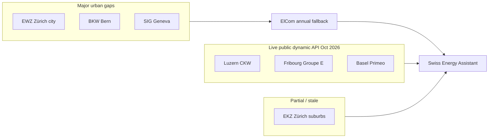

# 003 — Provider Landscape & Translating Notifications into Energy Savings

**Version:** 1.0  
**Created:** 30 October 2026  
**Author:** Project AI Architect  
**Source:** Live API scan (30 Swiss distribution operators), `001_understanding_and_wbs.md`, backend provider adapters  
**Related:** Swiss Energy Assistant product roadmap (advice-first EMS boundary)  

---

## TABLE OF CONTENTS

**Topic A — Swiss Electricity Provider Landscape for Dynamic Tariffs**

1. [Executive Summary (Topic A)](#1-executive-summary-topic-a)
2. [SmartGridready Standard & Common JSON Schema](#2-smartgridready-standard--common-json-schema)
3. [Scan Results: 30 Providers, 3 Live Public APIs](#3-scan-results-30-providers-3-live-public-apis)
4. [Why Only 3 of 30 Are Publicly Accessible](#4-why-only-3-of-30-are-publicly-accessible)
5. [Strategies to Expand Provider Coverage](#5-strategies-to-expand-provider-coverage)
6. [Geographic Coverage & Regional Gaps](#6-geographic-coverage--regional-gaps)
7. [Market Opportunity: Addressable Households](#7-market-opportunity-addressable-households)

**Topic B — Translating Notifications into Real Energy Savings**

8. [Executive Summary (Topic B)](#8-executive-summary-topic-b)
9. [Current Product Gap: Timing vs. Verified Savings](#9-current-product-gap-timing-vs-verified-savings)
10. [Phase 1 — Immediate (App-Only)](#10-phase-1--immediate-app-only)
11. [Phase 2 — Smart Monitoring (myStrom & Measurement)](#11-phase-2--smart-monitoring-mystrom--measurement)
12. [Phase 3 — Automated Control (EV, Heat Pump, Hot Water)](#12-phase-3--automated-control-ev-heat-pump-hot-water)
13. [Phase 4 — Solar Integration & Self-Consumption](#13-phase-4--solar-integration--self-consumption)
14. [Savings Estimation Model](#14-savings-estimation-model)
15. [Implementation Priorities & Risk Notes](#15-implementation-priorities--risk-notes)

**Appendices**

- [Appendix A — Non-Responding Provider List (Scan)](#appendix-a--non-responding-provider-list-scan)
- [Appendix B — Glossary & Cross-References](#appendix-b--glossary--cross-references)

---

## 1. Executive Summary (Topic A)

In October 2026 we systematically probed **30 Swiss electricity distribution operators** for **public, SmartGridready-compatible dynamic tariff APIs** (unauthenticated `GET`, JSON day-ahead price schedules). The outcome is stark but actionable:

| Outcome | Count | Share |
|---------|------:|------:|
| **Working public API** (live day-ahead data) | 3 | 10% |
| **Endpoint exists but unusable** (stale/test) | 1 | 3% |
| **No public response** (timeout, 404, auth wall, or unknown URL) | 26 | 87% |

The three production-grade feeds—**CKW**, **Groupe E**, and **Primeo**—each expose **96 intervals × 15 minutes** (typical calendar day), with observed mean **integrated** prices of roughly **21.4**, **23.6**, and **28.7 Rp/kWh** respectively at scan time. **EKZ** exposes a schema-compatible endpoint but returned **2025 placeholder data** (~300 Rp/kWh), unsuitable for user-facing recommendations without explicit staleness handling.

This landscape defines the **near-term TAM** for a tariff-intelligence app: strong coverage in **Luzern (CKW)**, **Fribourg (Groupe E)**, and **Basel (Primeo)**, with large Swiss population centers (Zürich, Bern, Geneva, Ticino, Eastern Switzerland) still dependent on **annual ElCom benchmarks**, **HT/NT heuristics**, or **provider outreach** until more APIs go live—accelerated in part by **January 2027 transparency expectations** for dynamic products (see document 001, §8).

---

## 2. SmartGridready Standard & Common JSON Schema

### 2.1 What SmartGridready Is

**SmartGridready (SGR)** is a Swiss industry initiative that defines **interoperability profiles** between energy devices, home energy managers, and **utility tariff information systems**. For our product, the relevant slice is the **OpenAPI-based tariff publication interface** (often referenced as SmartGridready OpenAPI v2 in project sources [S9]): a **machine-readable day-ahead schedule** that an Energy Management System (EMS) or third-party app can ingest to schedule loads.

SGR matters because it gives **one parsing pipeline** for multiple utilities instead of 26 bespoke scrapers.

### 2.2 Why Swiss Providers Converge on the Same Schema

Several forces push Swiss grid operators toward a **shared JSON shape**:

1. **EMS certification and enrollment** — Products like EKZ and Primeo dynamic tariffs explicitly require a **compatible EMS**. Vendors and utilities prefer one contract schema over per-canton formats.
2. **2027 transparency pressure** — Dynamic tariff offerings increasingly need **predictable day-ahead publication**; a standard payload reduces integration cost for portals, apps, and device OEMs.
3. **Operational symmetry** — Quarter-hour **Leistungspreise** (capacity/time-varying network components) and dynamic energy add-ons naturally map to **interval arrays** with start/end timestamps.
4. **Vendor implementations** — Several operators host tariffs on **Azure API Management** or similar gateways (e.g. Groupe E), often generated from the same OpenAPI template.

### 2.3 Observed Payload Structure (All Scanned APIs)

Every responding endpoint followed the same logical model (field names consistent across CKW, Groupe E, Primeo, EKZ):

| Field / block | Role |
|---------------|------|
| `publication_timestamp` | When the schedule was published (day-ahead cut-off indicator) |
| `tariff_name` | Commercial product label (when present) |
| `prices[]` | Ordered list of intervals for the delivery day |
| `prices[].start_timestamp` / `end_timestamp` | Interval bounds (ISO 8601; local offset common) |
| `prices[].grid` | Network / grid usage component (often Rp/kWh or CHF/kWh per nested `value`) |
| `prices[].electricity` | Energy supply component (when split) |
| `prices[].integrated` | Combined or bill-relevant all-in interval price (when provided) |
| `prices[].grid_usage` | Alternate naming for grid-related sub-components (provider-specific nesting) |

Our backend normalizer (`swiss_tariff.py`) treats **`integrated`** as the primary **ENERGY** line item and **`grid`** as **GRID_USAGE**, matching how comparisons are shown in the app UI.

### 2.4 Implementation Notes for Integrators

- **Units:** Confirm whether values are **Rp/kWh** vs **CHF/kWh**; Swiss APIs often use Rappen in JSON floats. Store internally as **Decimal CHF/kWh**.
- **Components vs. bill:** CKW’s public feed emphasizes **dynamic network**; Groupe E and Primeo may expose richer **integrated** views. Never imply “full bill” unless levies, metering, and VAT rules are modeled (document 001, §8).
- **DST:** A “normal” day has **96 × 15 min** slots; spring/autumn transition days may have **92 or 100** slots—validation must not assume exactly 96.
- **CORS:** **Groupe E** works from browsers without CORS blocks; others may require **server-side fetch** (our FastAPI backend already centralizes this).

---

## 3. Scan Results: 30 Providers, 3 Live Public APIs

### 3.1 Summary Table (October 2026 Scan)

| Provider | URL | Status | Intervals | Avg Price (integrated / observed) |
|----------|-----|--------|-----------|-----------------------------------|
| **CKW** | `https://e-ckw-public-data.de-c1.eu1.cloudhub.io/api/v1/netzinformationen/energie/dynamische-preise` | ✅ Working | 96 × 15 min | Ø **21.4** Rp/kWh |
| **Groupe E** | `https://api.tariffs.groupe-e.ch/v2/tariffs/` | ✅ Working (no CORS issues) | 96 × 15 min | Ø **23.6** Rp/kWh |
| **Primeo** | `https://tarife.primeo-energie.ch/api/v1/tariffs` | ✅ Working | 96 × 15 min | Ø **28.7** Rp/kWh |
| **EKZ** | `https://api.tariffs.ekz.ch/v1/tariffs` | ⚠️ Stale test data (2025) | 96 × 15 min | **300** Rp/kWh (placeholder) |

**Non-responding or no public API discovered in scan:** EWL, IWB, BKW, Romande Energie, SAK, EWZ, AEW, Repower, EWB, SIG, Viteos, WWZ, SH Power, Energie Thun, Alpiq, Axpo, IB Aarau, Eniwa, TB Wil, Stadtwerk Winterthur, EWN, EBS, EKW, EW Höfe, EWO, TB Glarus (see Appendix A).

### 3.2 Relative Price Level (Scan Snapshot)

Mean integrated price ordering at scan time: **CKW < Groupe E < Primeo**. This is a **single-day or short-window snapshot**, not a annual cost ranking—fixed fees, levies, and enrollment products dominate total bill for many households.

### 3.3 EKZ: Special Case

Treat EKZ as **schema-valid but operationally blocked**:

- Useful for **adapter regression tests** and **UI “coming soon”** states.
- Must **hard-block recommendations** when `publication_timestamp` or price magnitude fails sanity checks (e.g. sustained ~300 Rp/kWh).
- Product/marketing must repeat: EKZ dynamic enrollment expects **smart meter + certified EMS**—our app remains **advice-only** (document 001, §2).

---

## 4. Why Only 3 of 30 Are Publicly Accessible

The 10% public API rate is low but **not surprising** in the Swiss **monopoly basic-supply** model. Likely explanations bucket as follows:

### 4.1 Authentication & Commercial Gates

- **Azure API Management subscription keys** (Groupe E supports optional `Ocp-Apim-Subscription-Key` in our adapter)—many operators may default to **key-required** mode in production while leaving **public preview** only for select partners.
- **EMS/OEM allowlists** — Tariff feeds are primarily intended for **certified EMS vendors**, not open consumer apps; public URLs may be disabled or rate-limited to zero without registration.

### 4.2 Product Maturity

- Dynamic tariffs are **optional products**; many operators still market **fixed** or **HT/NT** only.
- **Primeo** public API presence ahead of full **2027 “Dynamisch”** rollout illustrates **infrastructure-before-product** staging.
- Several municipal utilities (**Stadtwerk Winterthur**, **TB Wil**, **SH Power**) may not yet operate **quarter-hour dynamic** network charges at all.

### 4.3 Security, Abuse, & Compliance

- Open tariff endpoints can be scraped for **commercial analytics**; utilities may prefer **ElCom annual datasets** for transparency and keep **intraday** data partner-only.
- **FADP/nDSG** and operational security favor **authenticated** access with audit trails.

### 4.4 Unknown or Non-Standard Endpoints

- Our scan used **documented or guessed SmartGridready paths**. Operators may publish only via:
  - **Customer portal** (session cookie)
  - **SGR device pairing** (local LAN)
  - **PDF/Excel day-ahead tables**
- **Alpiq / Axpo** appear in the scan list as **energy retailers/generators** rather than **local monopoly DSOs** for most households—wrong entity type yields “no API” even when group-level APIs exist elsewhere.

### 4.5 Technical Failures vs. Policy Blocks

Distinguish in monitoring:

| Signal | Interpretation |
|--------|----------------|
| HTTP 401/403 | Policy; pursue **API key** |
| HTTP 404 | Not deployed or URL drift |
| Timeout / TLS errors | Infra misconfig or geo-blocking |
| HTTP 200 + absurd values | **Staging** (EKZ pattern) |

---

## 5. Strategies to Expand Provider Coverage

### 5.1 Direct Provider Engagement (Highest ROI)

**Goal:** Move operators from `permission_required` to `approved_public` or **registered developer** tier.

| Action | Detail |
|--------|--------|
| Identify tariff product owner | Grid innovation / smart metering team |
| Request | Read-only day-ahead JSON, SmartGridready profile, test + prod keys |
| Offer | Attribution, load-shifting opt-in analytics, joint pilot (EV owners) |
| Legal | Written **redistribution rights** for mobile app (not just personal use) |

**Priority targets** (large populations, dynamic products rumored or partial endpoints):

- **EKZ** (Zürich region) — fix staging feed; largest single gap adjacent to existing adapter work.
- **EWZ** (City of Zürich), **SIG** (Geneva), **IWB** (Basel-Stadt grid overlap with Primeo territory—clarify boundaries).
- **BKW** (Bern/Mittelland), **AEW** (Aargau), **Repower** (Grisons).

### 5.2 ElCom & LINDAS — Annual Regulated Tariffs

**Role:** Universal **fallback** for comparison, bill explainer, and **HT/NT** approximations where live dynamic data is missing.

- **Coverage:** All municipalities; **H4** household profile aligns with ~4,500 kWh/year benchmarking.
- **Limitation:** **No intraday shape**—cannot compute quarter-hour optimal dishwasher start without assuming a synthetic load profile or generic Swiss peak/off-peak template.
- **Product framing:** “**Schweizer Preisexplorer**” and eligibility education—not “tomorrow’s 15-minute schedule.”

### 5.3 Web Scraping (Last Resort)

Use only when:

- No API after good-faith outreach, **and**
- **Robots.txt / ToS** permit automated access, **and**
- Legal review confirms **no database rights violation** under Swiss law.

Prefer scraping **official PDF/HTML day-ahead tables** into the same internal `PriceInterval` model. Budget high maintenance: **DOM changes break pipelines**.

### 5.4 Monitoring for New APIs

Operationalize a **weekly probe** (extend current 30-provider list):

1. HEAD/GET known SGR path patterns (`/v1/tariffs`, `/v2/tariffs/`, `dynamische-preise`).
2. Validate **96-slot** continuity and **sanity bounds** (e.g. integrated between 5–80 Rp/kWh).
3. Alert on **new HTTP 200** from previously failing hosts.
4. Track **publication_timestamp** lag vs. local cut-off (12:00 / 18:00 CET).

### 5.5 Partnerships

- **EMS vendors** — Co-marketing: we provide UX/notifications; they satisfy enrollment. Data via vendor cloud?
- **Smart meter gateways** — Some DSOs expose tariffs only to **SMGW** ecosystem partners.

---

## 6. Geographic Coverage & Regional Gaps

### 6.1 Where Live Dynamic APIs Cover Today

| Region / canton (illustrative) | Primary DSO / brand | Live public API in scan |
|--------------------------------|---------------------|-------------------------|
| **Luzern & Zentralschweiz** | CKW | ✅ CKW |
| **Fribourg / Broye / parts of VD/VS** | Groupe E | ✅ Groupe E |
| **Basel-Landschaft / Basel-area supply** | Primeo (Netz) | ✅ Primeo |
| **Zürich (suburban)** | EKZ | ⚠️ Stale endpoint only |
| **Zürich (city)** | EWZ | ❌ |
| **Bern** | BKW / local Stadtwerke | ❌ |
| **Basel-Stadt** | IWB | ❌ (Primeo covers much BL net area) |
| **Geneva** | SIG | ❌ |
| **Ticino** | AIL / local | ❌ |
| **Eastern CH** | Repower, EWO, etc. | ❌ |

### 6.2 Luzern, Fribourg, Basel — Depth vs. Neighbors

These three cantons align with our **three live APIs**—a deliberate product advantage:

- **Luzern (CKW):** Strong pilot recruitment potential; note CKW feed may emphasize **network** component—messaging must show **stacked bill view** (energy + grid + levies) using ElCom or user inputs.
- **Fribourg (Groupe E):** Full **VARIO** story; 15-minute resolution matches appliance optimization granularity.
- **Basel (Primeo):** High density, environmentally conscious households, **EV penetration** above rural average—good fit for notification-led shifting **if** users enroll in dynamic product when available.

**Adjacent gaps hurting “regional completeness”:**

- **Zug / Zürichsee north** (EKZ, EWZ) — economically similar users without live data.
- **Jura / Neuchâtel** — partially Romande Energie; no API.
- **Solothurn / Olten** — often Primeo-adjacent or AEW; no live feed in scan.

### 6.3 Map-Oriented View (Conceptual)



---

## 7. Market Opportunity: Addressable Households

### 7.1 Baseline Swiss Market

| Metric | Estimate | Source / assumption |
|--------|----------|---------------------|
| Total households | ~**4.5 million** | BFS approximate order of magnitude |
| Residential electricity use | ~**4,500 kWh/year** median | ElCom H4 profile (document 001) |
| Dynamic tariff enrollment today | **Low single-digit %** nationally | Product optional; EMS/meter constraints |
| HT/NT or fixed | **Majority** | Default basic supply |

### 7.2 Tiered Addressable Segments

| Tier | Who | Estimate | App value |
|------|-----|----------|-----------|
| **T1 — Live API + dynamic enrolled** | CKW / Groupe E / Primeo dynamic customers | **Tens of thousands** near-term | Full day-ahead optimization, CHF claims with confidence intervals |
| **T2 — Live API region, not yet enrolled** | Same DSO, fixed tariff | **100k+** in tri-canton core | Conversion funnel to dynamic products; still show **what-if** shifting on published network curves |
| **T3 — National HT/NT** | All Switzerland | **Millions** | Coarse scheduling (night vs day), bill transparency |
| **T4 — PV / EV growth** | ~**350k+ EVs** (CH trend), PV on ~**400k+** buildings | Growing | Phase 3–4 features unlock **CHF 300–800** narratives |

### 7.3 2027 Regulatory Upside

Mandatory **day-ahead publication** for dynamic offerings (document 001, §8) plausibly raises **T1** from tens of thousands toward **low hundreds of thousands** over 2027–2029 as products proliferate—**if** APIs are public or partner-accessible, not EMS-only silos.

### 7.4 Realistic Penetration Scenarios (3 Years)

| Scenario | Active users | Assumption |
|----------|-------------|------------|
| Conservative | 5,000 | Pilot cantons + word of mouth |
| Base | 25,000 | EKZ live + 2–3 new DSO keys |
| Optimistic | 100,000 | National HT/NT mode + strong PR around 2027 rules |

**Revenue implication (order of magnitude):** At CHF 3–8/month subscription or freemium premium, **25k users → CHF 0.9–2.4M ARR**—contingent on proving **verified savings** (Topic B).

---

## 8. Executive Summary (Topic B)

Today the Swiss Energy Assistant answers: **“When is electricity cheapest tomorrow?”** That reduces **expected cost** for shiftable loads but does not **prove** users changed behavior or **measure** kWh moved. Closing the loop requires a **progressive evidence ladder**:

1. **Self-reported adherence + counterfactual pricing** (immediate).
2. **Plug-level metering** (myStrom) for verification.
3. **Closed-loop control** (EV, heat pump SG-Ready, hot water).
4. **PV/battery optimization** for self-consumption and virtual metering scenarios.

Without step 1–2, marketing **“Save CHF 200/year”** risks skepticism; with them, savings claims become **auditable** and defensible under consumer protection norms.

---

## 9. Current Product Gap: Timing vs. Verified Savings

| Capability | Status | Limitation |
|------------|--------|------------|
| Day-ahead price fetch (3 providers) | ✅ | User may ignore notifications |
| Appliance duration & kWh model | ✅ | Assumes single contiguous run |
| Recommended start window | ✅ | No ground truth |
| Push reminders | ✅ / partial | No feedback loop by default |
| EMS / load control | ❌ MVP scope | By design (document 001) |

**Core equation we need to surface:**

\[
\text{Savings} = \sum_{\text{runs}} (\text{cost at baseline time} - \text{cost at actual time})
\]

Baseline time might be **user habit** (always 19:00), **peak average**, or **worst quartile**—must be **user-visible** to avoid greenwashing.

---

## 10. Phase 1 — Immediate (App-Only)

No new hardware; highest **velocity-to-trust** ratio.

### 10.1 Adherence Tracking

- After notification, prompt: **“Did you run the appliance in the suggested window?”** (Yes / No / Partial / Snooze).
- Optional **calendar export** (.ics) with deep link return for one-tap logging.
- Store **recommended_start**, **recommended_end**, **actual_reported_start** (user input).

### 10.2 CHF Savings Display

For each completed cycle:

1. Load **published interval prices** for recommended vs. actual window.
2. Multiply by **appliance kWh** (user profile or default load curve).
3. Show: **“You saved CHF 0.42 vs. your usual 19:00 start.”**

Show **ranges** when price data is grid-only (CKW): “Network component savings CHF X; total bill impact may differ.”

### 10.3 Gamification & Reporting

| Mechanic | Purpose |
|----------|---------|
| **Streaks** | Consecutive days following at least one recommendation |
| **Monthly report** | Aggregate CHF, kWh shifted, CO₂ optional (grid factor) |
| **Badges** | EV week, off-peak laundry, “no peak hours” month |
| **Leaderboard (opt-in)** | Canton-level anonymized comparison |

### 10.4 Data Model Additions (Conceptual)

- `RecommendationEvent` — tariff snapshot id, appliance id, suggested slot.
- `AdherenceEvent` — user confirmation, timestamp, source (manual/push).
- `SavingsLedger` — computed delta, baseline policy, confidence flag.

### 10.5 Success Metrics (Phase 1)

- **Notification → adherence rate** target: 25%+ in pilot.
- **Self-reported savings** sum/month active user: CHF 3–15 (consistent with model §14).

---

## 11. Phase 2 — Smart Monitoring (myStrom & Measurement)

### 11.1 Why myStrom

| Attribute | Detail |
|-----------|--------|
| Hardware | ~**CHF 36** consumer price point |
| Socket | **Swiss Type J** |
| API | **Local REST** on LAN |
| Measurement | Power (W), energy (Wh), switching |

**Caveat:** Standard plug **~10 A (~2,300 W)** — suitable for **dishwasher/washing machine** on dedicated circuit awareness; **not** for oven or whole-home. Document load limits prominently (see specs/chatgpt_homeassistant notes in repo).

### 11.2 Architecture

```
myStrom plug → LAN REST → Home assistant / bridge → our backend (opt-in)
                                      ↓
                           Verified run detection (power > threshold)
                                      ↓
                           Match to tariff intervals → SavingsLedger
```

Prefer **on-device or Home Assistant** mediation to avoid shipping raw home IP data without consent.

### 11.3 Verification Logic

1. Detect **start** when power > **P_on** for 2+ minutes.
2. Detect **end** when power < **P_off** sustained.
3. Integrate **Wh** over run; compare to **counterfactual** schedule (same energy, different start time per optimizer).
4. Flag **partial loads** (interrupted cycles).

### 11.4 Actual vs. Claimed Savings

| Method | Trust level |
|--------|-------------|
| User self-report | Low |
| Price × assumed kWh | Medium |
| **Metered Wh × interval prices** | **High** |

Phase 2 unlocks marketing language: **“Verified savings.”**

---

## 12. Phase 3 — Automated Control (EV, Heat Pump, Hot Water)

Advice becomes **action**—revisit EMS regulatory boundary; likely **partnership** or **user-owned automation** (Home Assistant) rather than claiming EMS certification ourselves.

### 12.1 EV Charger Scheduling

| Vendor | Integration angle |
|--------|-------------------|
| **go-e** | HTTP API on local charger |
| **Easee** | Cloud API (account linking) |

**Value:** EV energy **~3,000–5,000 kWh/year** per vehicle—dominates shiftable load for many households. Scheduling to **lowest 4–6 hours** can capture **most of the tariff spread**.

**Risk:** User mobility needs (**departure time constraint**) dominate pure price optimization.

### 12.2 Heat Pump SG-Ready

- **SG-Ready** contacts signal **recommended on/off** periods from EMS.
- Our app could output **price-based signals** to a **Home Assistant SG-Ready bridge**, not directly to heat pump contacts without certified hardware.

### 12.3 Hot Water Tank Scheduling

- **Immersion heater / buffer tank** with **4–8 kWh** daily thermal storage maps well to **off-peak windows**.
- Requires **knowing tank size**, **legionella** hygiene rules, and **comfort bounds**.

### 12.4 Phase 3 Savings Uplift

Automating EV + hot water can move **15–25%** of annual kWh from peak to off-peak vs. **5–10%** manual appliance shifting—see §14.

---

## 13. Phase 4 — Solar Integration & Self-Consumption

### 13.1 Inverter Data Sources

| OEM | Typical access |
|-----|----------------|
| **Huawei** | FusionSolar cloud / Modbus |
| **SMA** | Sunny Portal / Modbus |
| **Fronius** | Solar API (local) |

Read-only first: **production forecast vs. actual**, overlay **import prices**, recommend **consume now** vs **export**.

### 13.2 Self-Consumption Optimization

Objective: minimize **grid import cost** + maximize **self-use**:

- Run dishwasher when **PV surplus > load** AND price low.
- **Battery charge** when price low or PV excess; **discharge** during peak import prices if cycle limits allow.

### 13.3 Virtual Net Metering / Community Models

Where legal structures exist (ZEV, vZEV, new 2027 remuneration rules), app can show **prosumer balance**—**separate** from dynamic import tariff logic (document 001 distinguishes import vs. feed-in remuneration).

### 13.4 Phase 4 Savings Band

Households with **PV + battery + dynamic tariff** often target **CHF 300–800/year** incremental benefit vs. naive self-consumption—highly dependent on **system size**, **orientation**, and **load flexibility** (§14.4).

---

## 14. Savings Estimation Model

### 14.1 Baseline Assumptions

| Parameter | Value |
|-----------|-------|
| Annual consumption | **4,500 kWh** |
| Shiftable share | **~30%** → **1,350 kWh/year** |
| Shiftable breakdown (illustrative) | Washing 120 kWh, dishwasher 180 kWh, dryer 250 kWh, EV 3,000 kWh (if present), misc 200 kWh — normalize to household without EV for base case |

**Without EV:** shiftable pool often **~550–800 kWh** (~12–18% of total).  
**With EV:** shiftable pool **~2,500+ kWh** possible.

### 14.2 Price Spread

From live APIs, typical **intraday integrated spread** (max − min) often **10–15 Rp/kWh** on dynamic days; conservative planning uses **Δp = 0.12 CHF/kWh** average delta captured.

### 14.3 Formula

Let \(E_s\) = successfully shifted energy (kWh/year), \( \Delta p \) = average price improvement (CHF/kWh):

\[
\text{Annual savings (CHF)} = E_s \times \Delta p
\]

**Capture rate** \( \eta \) accounts for adherence and partial shifts: \( E_s = \eta \times E_{\text{shiftable}} \).

| Persona | \(E_{\text{shiftable}}\) | \( \eta \) | \( \Delta p \) | Savings |
|---------|-------------------------|-----------|----------------|---------|
| Manual appliances only | 700 kWh | 0.35 | 0.10 | **CHF 25** |
| Manual + good adherence | 700 kWh | 0.60 | 0.12 | **CHF 50** |
| + EV manual scheduling | 2,200 kWh | 0.50 | 0.12 | **CHF 130** |
| + EV automated (Phase 3) | 2,500 kWh | 0.75 | 0.13 | **CHF 240** |

Aligns with user-facing range **CHF 50–200** for **dynamic tariff households without full automation**; upper bound needs **EV or high shiftable load**.

### 14.4 Solar + Battery Incremental

| Factor | Typical |
|--------|---------|
| PV size | 8–15 kWp |
| Self-consumption lift from optimization | **5–15%** of production |
| Value per kWh | blend of import price avoided + export tariff |

Order-of-magnitude: **CHF 300–800/year** vs. unoptimized control—consistent with Phase 4 marketing band when **battery + dynamic import** coincide.

### 14.5 Display Guidelines

- Always show **assumptions** expandable panel.
- Use **ranges** (p10–p90) when spread volatile.
- Separate **network-only** CKW savings from **all-in** where data missing.

---

## 15. Implementation Priorities & Risk Notes

### 15.1 Recommended Sequence

| Order | Initiative | Depends on |
|------:|------------|------------|
| 1 | Phase 1 adherence + savings ledger | Live tariffs |
| 2 | EKZ production feed or key | Provider outreach |
| 3 | Weekly 30-provider monitor | DevOps cron |
| 4 | myStrom pilot (10–20 homes) | Phase 1 metrics |
| 5 | EV API via HA integration | Legal review |
| 6 | PV read-only dashboard | OEM API keys |

### 15.2 Risks

| Risk | Mitigation |
|------|------------|
| Overstated savings | Counterfactual transparency; metered Phase 2 |
| EMS misclassification | Never claim EMS certification |
| CKW partial component | Stack ElCom + user bill inputs |
| User safety (loads > plug rating) | Hard limits in UI |
| API loss (key rotation) | Stale cache + multi-provider |

### 15.3 Link to Document 001

- Provider adapters & WBS items **3.3–3.8** remain valid; this document adds **coverage economics** and **savings proof path**.
- Jan **2027** rules increase urgency on **§5.4 Monitoring** and ElCom **2027 dataset** import.

---

## Appendix A — Non-Responding Provider List (Scan)

The following operators did **not** expose a working public SmartGridready-style dynamic tariff API in the October 2026 scan (timeouts, 404, auth required, or no discoverable endpoint):

EWL · IWB · BKW · Romande Energie · SAK · EWZ · AEW · Repower · EWB · SIG · Viteos · WWZ · SH Power · Energie Thun · Alpiq · Axpo · IB Aarau · Eniwa · TB Wil · Stadtwerk Winterthur · EWN · EBS · EKW · EW Höfe · EWO · TB Glarus

**Re-scan policy:** Re-test quarterly and on ElCom/market announcements; add newly published OpenAPI URLs to version control with retrieval date.

---

## Appendix B — Glossary & Cross-References

| Term | Meaning |
|------|---------|
| **DSO** | Distribution system operator (Netzbetreiber) |
| **SGR** | SmartGridready interoperability standard |
| **Integrated price** | Combined interval value used for all-in comparisons when present |
| **EMS** | Certified energy management system (provider enrollment) |
| **Shiftable load** | Energy consumption movable by ≥15 minutes without material comfort loss |

**Cross-references:**

- Document **001** §7 — Provider API landscape & adapter pattern  
- Document **001** §8 — January 2027 daily price transparency  
- Document **001** §9 — Solar & IoT future stages  
- Backend: `backend/app/integrations/providers/swiss_tariff.py` — live CKW, Groupe E, Primeo normalization  

---

**Next step:** Implement Phase 1 `SavingsLedger` + adherence prompts in the mobile/web client; parallel outreach template to EKZ/EWZ/SIG for API registration; deploy automated weekly provider probe reporting into `#ops` or email digest.
